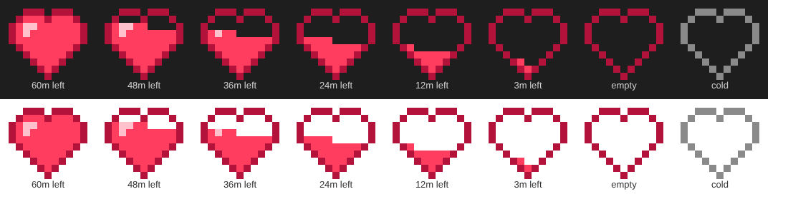

# cache-heart ♥

A Claude Code mod that puts a little pixel-art heart in the prompt footer, beside the mode labels,
showing whether your prompt cache is still warm. The heart drains from the top as the cache gets
close to expiring, down to a bare outline, and turns grey once the cache has gone cold.



Beside it, dim text shows the minutes left and how much of the last request was read from cache,
e.g. `42m · 90%`. Before the first response it reads `cache`; after expiry, `cold`.

## Why

Claude Code re-sends the whole conversation on every turn. Prompt caching makes that cheap: cache
reads cost about 10% of normal input. But the cache expires a while after the last request (1 hour
on long-TTL sessions, 5 minutes on short ones). Come back after it has expired, and your next message
re-processes the entire history at full price, on the API bill or against your subscription's usage
limits. The heart shows you at a glance how long you have.

## Install

At the prompt of a Claude Code terminal session:

```
/plugin install cache-heart --marketplace mileshh515/claude-cache-heart
```

Answer `y` to add the marketplace, then pick a scope (user scope makes it load in every session).

From a shell:

```bash
claude plugin install cache-heart --marketplace mileshh515/claude-cache-heart
```

In the Claude desktop app, where `/plugin` does not run: click **+** next to the prompt box, then
**Plugins**, **Add marketplace** with `mileshh515/claude-cache-heart`, then **Add plugin**.

## Settings

| Option | Values | Default | Meaning |
|---|---|---|---|
| `ttlMinutes` | `60`, `5` | `60` | How long your session's prompt cache lives. Pick `5` if your sessions use the short cache TTL. |

Change it in `/config`, or under `pluginConfigs` in your settings.

## Where it shows

| Surface | What you see |
|---|---|
| Desktop app | The pixel heart as a crisp SVG |
| Terminal (kitty, Ghostty, iTerm2 3.5+) | The pixel heart as an inline image |
| Other terminals | A text heart, `♥` or `♡` |
| Mobile app | Nothing: the prompt footer isn't open to mods there |

## How it works

- After every response on the main thread (subagents don't keep your conversation's cache warm, so
  they're ignored), the mod records the time and the API's cache usage: tokens read from cache,
  written to it, and uncached.
- A 30-second timer redraws the heart, so it drains while you're away.
- The heart is an 11×10 grid with a one-pixel outline around 47 interior pixels. The interior fills
  from the bottom up in proportion to the time left, so it drains from the top one pixel at a time.
  The shape lives in `hooks/pixels.ts` as ten lines of `X`s and dots, if you want to redraw it.

## Pairs well with cachebeat

The heart only shows the cache. To keep it warm while you step away, use
[cachebeat](https://github.com/ARahim3/cachebeat). Each heartbeat it sends is a real request, so you
can watch the heart refill when one lands.

## Development

```bash
claude plugin validate .
claude plugin test .
```

## Acknowledgements

This mod was inspired by [cachebeat](https://github.com/ARahim3/cachebeat) by
[ARahim3](https://github.com/ARahim3), whose write-up of the prompt-cache "idle tax" and how to read
a response's `cache_read_input_tokens` / `cache_creation_input_tokens` is the basis for the heart's
idea. No code was copied: cache-heart reads the same numbers through Claude Code's mod API rather
than the session transcript. Built with [Claude Code](https://claude.com/claude-code).

## License

MIT
